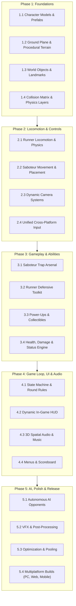
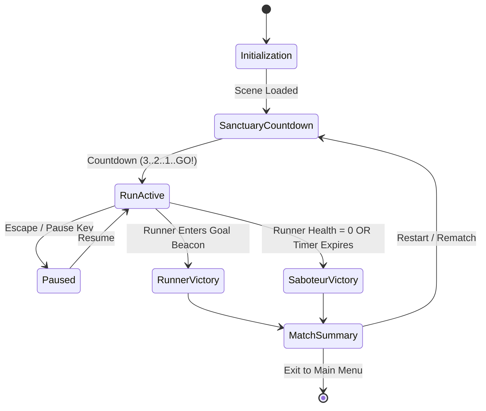

# AetherBound — 5-Phase Game Production Plan

> **Project**: AetherBound (3D Asymmetrical Action-Runner)  
> **Engine**: Unity 6 (6000.6.6f1) • **Render Pipeline**: Universal Render Pipeline (URP)  
> **Target Platforms**: PC (Windows / Mac), WebGL (`AetherBound_Web`), Mobile (Android / iOS)  
> **Document Status**: Active Roadmap • **Created**: October 2026

---

## Executive Summary & Architecture Overview

**AetherBound** is an asymmetrical 3D action game pitting the **Runner** against the **Saboteur**:
- The **Runner** (Third-Person, fast-paced parkour) must navigate procedural terrain, avoid hazards, collect Aether shards, and reach the glowing **Goal Beacon** before time expires.
- The **Saboteur** (Top-Down tactical cursor or roaming phantom) deploys physical barricades, spike traps, mud quagmires, and rolling boulders to delay or eliminate the Runner.



---

## Current Status Tracker

| Phase | Milestone Description | Status | Key Deliverables |
|:---:|---|:---:|---|
| **Phase 1** | **Foundations: Character, Plane & Objects** | **100% Complete** | **Phase 1 Complete**: 3D Knight, Rogue & Mage avatars; decoupled visual rotation; green grass field level plain; Spawn Sanctuary safe zone & guardian pylons; Goal Beacon sky beam & monolith; procedural terrain; physics layers & collision matrix configured. |
| **Phase 2** | **Locomotion, Physics & Controls** | **100% Complete** | **Phase 2 Complete**: Full dual-control parity (PC Keyboard/Mouse & Mobile touch); crisp -24 m/s² gravity, coyote time (0.15s), jump buffer (0.12s); third-person chase camera with sphere-cast obstacle clipping avoidance; Saboteur dual-view (FreeRoam chase & Overhead tactical point-and-click placement); Shadow Blink ability with obstacle safety & procedural burst VFX; procedural character animator with squash & stretch, banking tilt & landing cushions. |
| **Phase 3** | **Gameplay Systems, Traps & Power-Ups** | **100% Complete** | **Phase 3 Complete**: Complete Saboteur trap arsenal (Barrier Walls, Spring Spikes, Explosive TNT Barrels with chain reactions, Mud Quagmire, Kinetic Rolling Boulders with continuous dynamic physics); Runner defensive suite (Aether Dash with i-frames, Kinetic Deflection Pulse shockwave, Wings of Light Double Jump, Aegis Shield bubble); Golden Chest power-up pickups with balanced path distribution; full IDamageable interface with typed damage & status effects. |
| **Phase 4** | **Game Loop, Objectives, HUD & Audio** | **40% Complete** | GameManager states; timer countdown; UIManager canvas; basic AudioManager sound hooks. |
| **Phase 5** | **AI, Polish, Optimization & Deployment** | **25% Complete** | AISaboteur initial prototype; WebGL build target; needs particle effects, pooling & build polish. |

---

## Detailed 5-Phase Production Plan

---

### Phase 1: Foundations — Characters, Plane & Environmental Objects
*Goal: Establish all visual, geometrical, collision, and architectural primitives of the game world.*

```
Assets/
├── Art/
│   ├── KayKit_Characters/ (Knight, Rogue, Mage meshes & textures)
│   ├── KayKit_Dungeon/    (Walls, Spikes, Barrels, Chests, Pillars)
│   └── CC0_Nature/        (Pine, Rounded Trees, Monolith)
├── Materials/Imported/    (URP Lit material assets)
├── Prefabs/
│   ├── Characters/        (Runner_Character, Saboteur_Character)
│   ├── Environment/       (SpawnSanctuaryGround, Trees)
│   └── Imported/          (Individual 3D props)
```

#### 1.1 Character Entities & Prefab Architecture
- **Runner Avatar (`Knight`)**:
  - Armored adventurer mesh (`Knight.fbx`) with URP Lit texture atlas.
  - Child visual container `AvatarVisuals` isolated from root transform for decoupled rotation.
  - Elemental visual accent: Cyan Aether aura ring (`AetherAuraRing`) and local point light.
- **Saboteur Avatar (`RogueHooded` / `Mage`)**:
  - Cloaked assassin mesh (`RogueHooded.fbx`) with stylized dark leather palette.
  - Elemental visual accent: Crimson/Purple shadow aura (`ShadowAuraRing`).
  - Standby AI avatar: `AISaboteur_Mage` for autonomous offline play.
- **Components & Builders**:
  - [`CharacterModelBuilder.cs`](file:///C:/Users/Dell/OneDrive/Desktop/myGame/AetherBound_Unity/Assets/Scripts/Entities/CharacterModelBuilder.cs): Dynamic runtime/edit-time builder instantiating 3D meshes onto entity roots.

#### 1.2 Ground Plane & Procedural Terrain System
- **Central Spawn Sanctuary (`SpawnSanctuary`)**:
  - Circular raised dais with carved stone runic rings ([`SpawnSanctuary.cs`](file:///C:/Users/Dell/OneDrive/Desktop/myGame/AetherBound_Unity/Assets/Scripts/World/SpawnSanctuary.cs)).
  - Non-combat safe zone where Runner cannot be damaged or targeted by traps during countdown.
  - Four guardian pylon towers (`Sanctuary_Pillar`) topped with lit braziers (`Beacon_Torch`).
- **Procedural Mesh Terrain (`WorldManager`)**:
  - Chunk-based terrain generation powered by [`FastSimplexNoise.cs`](file:///C:/Users/Dell/OneDrive/Desktop/myGame/AetherBound_Unity/Assets/Scripts/World/FastSimplexNoise.cs).
  - Dynamic vertex deformation with height query API: `WorldManager.Instance.GetHeightAt(x, z)`.
  - Splatmap vertex colors distinguishing stone paths, grassy meadows, and dirt hills.
  - Infinite or multi-stage corridor bounds preventing player falling into the void.

#### 1.3 Environmental Props & Landmarks
- **Foliage & Nature (`EnvironmentPropBuilder`)**:
  - Procedural scattering of `Tree_Pine`, `Tree_Rounded`, and `Tree_DeadPine` prefabs.
  - Surface normal alignment to sit naturally on rolling slopes.
  - Radius checks preventing tree generation directly on primary runner pathways.
- **Landmark: Goal Beacon (`GoalBeacon`)**:
  - Towering sky-beam cylinder visible from any terrain point ([`GoalBeacon.cs`](file:///C:/Users/Dell/OneDrive/Desktop/myGame/AetherBound_Unity/Assets/Scripts/World/GoalBeacon.cs)).
  - Ancient monolith centerpiece (`Sanctuary_Monolith`) encased inside 3 concentric rotating energy rings.
  - Trigger volume detecting Runner arrival to trigger the victory sequence.
- **Environmental Hazards**:
  - Water pools ([`WaterHazard.cs`](file:///C:/Users/Dell/OneDrive/Desktop/myGame/AetherBound_Unity/Assets/Scripts/World/WaterHazard.cs)) causing immediate drowning respawn or heavy slow.
  - Natural ravines and jump gaps requiring sprint jumps.

#### 1.4 Physics Layers & Collision Matrix
- Define Unity layers:
  - `Default` (0), `TransparentFX` (1), `Ignore Raycast` (2), `Water` (4), `UI` (5).
  - Custom Layers: `Player` (8), `Saboteur` (9), `Obstacle` (10), `Ground` (11), `PowerUp` (12), `Hazard` (13).
- Configure Physics Matrix:
  - `Player` collides with `Ground`, `Obstacle`, `PowerUp` (trigger), `Hazard` (trigger).
  - `Saboteur` phantom raycast queries only `Ground` and `Obstacle`.
  - Disable unnecessary matrix pairs (`Player` vs `Player`, `Obstacle` vs `PowerUp`).

---

### Phase 2: Core Movement & Physics Controls
*Goal: Deliver responsive, fluid 3D locomotion for both player roles across keyboard, mouse, and touch.*

```
Assets/Scripts/
├── Entities/
│   ├── RunnerController.cs
│   ├── SaboteurController.cs
│   └── ProceduralCharacterAnimator.cs
├── Input/
│   ├── GameInput.cs
│   ├── CursorManager.cs
│   ├── MobileInputManager.cs
│   ├── VirtualJoystick.cs
│   └── TouchLookZone.cs
```

#### 2.1 Runner Locomotion & Physics Engine
- **Core Controller ([`RunnerController.cs`](file:///C:/Users/Dell/OneDrive/Desktop/myGame/AetherBound_Unity/Assets/Scripts/Entities/RunnerController.cs))**:
  - Standard `CharacterController` with smooth sub-step collision detection.
  - Movement parameter configuration:
    - Base Move Speed: `7.5 m/s` • Sprint Speed: `11.5 m/s` • Acceleration: `18 m/s²`.
    - Jump Height: `2.4 m` • Gravity: `-24.0 m/s²` (fast, crisp descent feel).
    - Coyote Time (`0.15s`) and Jump Buffer (`0.12s`) for platformer responsiveness.
  - Slope sliding & step-offset handling (auto-step over small curbs up to `0.4m`).
- **Procedural Character Animation ([`ProceduralCharacterAnimator.cs`](file:///C:/Users/Dell/OneDrive/Desktop/myGame/AetherBound_Unity/Assets/Scripts/Entities/ProceduralCharacterAnimator.cs))**:
  - Code-driven walk/run cycle: subtle torso bobbing, hip sway, and forward leaning based on acceleration.
  - Jump squash & stretch on launch, landing cushion upon ground impact.
  - Banking rotation when cornering hard at high speed.

#### 2.2 Saboteur Movement & Viewpoint Mechanics
- **Dual-Mode Control ([`SaboteurController.cs`](file:///C:/Users/Dell/OneDrive/Desktop/myGame/AetherBound_Unity/Assets/Scripts/Entities/SaboteurController.cs))**:
  - **Mode A: Free-Roaming Phantom**:
    - High-mobility stealth avatar capable of hovering or traversing obstacles unhindered.
    - Shadow Blink / Teleport to reposition along the course instantly.
  - **Mode B: Tactical Placement Cursor**:
    - Unlocked cursor mode ([`CursorManager.cs`](file:///C:/Users/Dell/OneDrive/Desktop/myGame/AetherBound_Unity/Assets/Scripts/Input/CursorManager.cs)).
    - 3D Raycast cursor projecting onto ground geometry to preview trap placement silhouettes (Green = Valid, Red = Obstructed / Out of Range).
- **Resource Management**:
  - Saboteur Energy / Mana meter that recharges over time.
  - Trap costs (e.g., Wall: `25 MP`, Spikes: `15 MP`, Boulder: `40 MP`).

#### 2.3 Dynamic Camera Systems
- **Runner Third-Person Chase Camera**:
  - Smooth Follow algorithm with configurable distance (`5.5m`), height offset (`2.2m`), and pitch angle (`15°`).
  - Mouse-look yaw/pitch control with vertical clamps (`-25°` to `+65°`).
  - Camera sphere-cast clipping prevention: pushes camera forward smoothly when a wall or tree intervenes.
- **Saboteur Overhead Tactical Camera**:
  - Angled isometric / high orthographic view (`45°` pitch, `25m` altitude).
  - Pan via WASD, edge-scrolling, or middle-click drag.
  - Quick-jump hotkey (Spacebar) to snap camera directly to the Runner's current location.

#### 2.4 Unified Cross-Platform Input Integration
- **Desktop (Mouse & Keyboard / Gamepad)**:
  - WASD / Left Stick: 2D movement vector relative to active camera azimuth.
  - Mouse Delta / Right Stick: View rotation.
  - Spacebar / South Button: Jump.
  - Left Shift / Right Trigger: Sprint.
  - Left Click / Right Click: Primary ability / Dash / Place trap.
- **Mobile Touch Controls ([`MobileInputManager.cs`](file:///C:/Users/Dell/OneDrive/Desktop/myGame/AetherBound_Unity/Assets/Scripts/Input/MobileInputManager.cs))**:
  - Left Screen Half: Dynamic floating [`VirtualJoystick.cs`](file:///C:/Users/Dell/OneDrive/Desktop/myGame/AetherBound_Unity/Assets/Scripts/Input/VirtualJoystick.cs) repositioning under thumb touch.
  - Right Screen Half: Free look drag zone ([`TouchLookZone.cs`](file:///C:/Users/Dell/OneDrive/Desktop/myGame/AetherBound_Unity/Assets/Scripts/Input/TouchLookZone.cs)).
  - On-screen touch buttons for Jump, Sprint, and Ability triggers.

---

### Phase 3: Gameplay Mechanics, Traps, Obstacles & Power-Ups
*Goal: Construct the asymmetrical gameplay conflict — lethal trap placement versus agile evasion.*

```
Assets/Scripts/
├── Obstacles/
│   ├── ObstacleBase.cs
│   ├── ObstacleManager.cs
│   ├── BarrierWall.cs
│   ├── SpikeBarricade.cs
│   ├── ExplosiveBarrel.cs
│   ├── MudTrap.cs
│   └── RollingBoulder.cs
└── PowerUps/
    ├── PowerUpBase.cs
    ├── PowerUpItem.cs
    └── PowerUpManager.cs
```

#### 3.1 Saboteur Trap & Obstacle Arsenal
- **Base Architecture ([`ObstacleBase.cs`](file:///C:/Users/Dell/OneDrive/Desktop/myGame/AetherBound_Unity/Assets/Scripts/Obstacles/ObstacleBase.cs))**:
  - Common lifecycle: `Spawning` (hologram preview) -> `Active` (collidable) -> `Triggered` -> `Destroyed/Despawned`.
  - Cooldown timers, durability, and lifetime despawns.
- **Concrete Obstacle Types**:
  1. **Barrier Wall (`BarrierWall.cs` / `Obstacle_Wall.prefab`)**:
     - 3D stone wall blockading corridors; forces Runner to vault, mantle, or detour.
  2. **Spike Barricade (`SpikeBarricade.cs` / `Obstacle_Spikes.prefab`)**:
     - Retractable iron spikes. Spring upward when Runner enters radius, dealing `30` damage and applying a `50%` slow for `2s`.
  3. **Explosive Barrel (`ExplosiveBarrel.cs` / `Obstacle_Barrel.prefab`)**:
     - Volatile TNT keg. Detonates on impact or when triggered, delivering radial knockback force (`12 m/s`) and `45` damage.
  4. **Mud Quagmire (`MudTrap.cs`)**:
     - Surface decal reducing runner movement speed by `60%` and disabling sprint while wading through.
  5. **Rolling Boulder (`RollingBoulder.cs`)**:
     - Heavy spherical boulder with physics `Rigidbody` rolling down incline slopes, crushing anything in its path.

#### 3.2 Runner Defensive & Mobility Abilities
- **Aether Dash**:
  - High-speed forward burst (`18 m/s` for `0.35s`) on a `4s` cooldown.
  - Grants invulnerability frames (i-frames) against spike traps and explosions during dash.
- **Kinetic Deflection Pulse**:
  - Short-range radial shockwave pushing away nearby rolling boulders or destroying incoming barrels.
- **Beacon Sense Compass**:
  - HUD overlay pulse pointing directly to the hidden Goal Beacon through fog and hills.

#### 3.3 Power-Ups & Collectible Pickups
- **Golden Chests ([`PowerUpItem.cs`](file:///C:/Users/Dell/OneDrive/Desktop/myGame/AetherBound_Unity/Assets/Scripts/PowerUps/PowerUpItem.cs) / `PowerUp_Chest.prefab`)**:
  - Floating, gently rotating golden chests emitting particle sparkles.
  - Pickups granted upon Runner contact:
    - **Aether Surge**: Instant speed boost (`+35%`) for `5 seconds`.
    - **Aegis Shield**: Absorbs the next 1 fatal obstacle hit.
    - **Wings of Light**: Grants a mid-air double-jump for `15 seconds`.
- **Dynamic Spawning Engine ([`PowerUpManager.cs`](file:///C:/Users/Dell/OneDrive/Desktop/myGame/AetherBound_Unity/Assets/Scripts/PowerUps/PowerUpManager.cs))**:
  - Balances match pacing: spawns extra chests along riskier alternative pathways.

#### 3.4 Health, Damage & Status Effect System
- **Damage Pipeline**:
  - Clean `IDamageable` interface: `TakeDamage(float amount, Vector3 hitDirection, DamageType type)`.
  - Screen blood/frost vignetting and controller rumble on damage.
- **Status Effects**:
  - Slow, Root, Stun, Knockback, Speed Boost, Invulnerable.

---

### Phase 4: Core Game Loop, Objectives, HUD & Audio
*Goal: Assemble match rules, win/loss evaluation, scoring, visual feedback, and auditory immersion.*

```
Assets/Scripts/
├── Core/
│   ├── GameManager.cs
│   ├── GameConfig.cs
│   └── GameBootstrap.cs
├── UI/
│   └── UIManager.cs
└── Audio/
    └── AudioManager.cs
```

#### 4.1 Game State Machine & Match Loop
- **State Machine ([`GameManager.cs`](file:///C:/Users/Dell/OneDrive/Desktop/myGame/AetherBound_Unity/Assets/Scripts/Core/GameManager.cs))**:



- **Objective Conditions**:
  - **Runner Victory**: Reach the Goal Beacon perimeter before time runs out.
  - **Saboteur Victory**: Deplete Runner's health to `0` or stall the Runner until the round timer (`90 seconds`) reaches `0:00`.
- **Sanctuary Checkpoint System**:
  - Runner respawns at the latest passed sanctuary pedestal if eliminated with remaining lives.

#### 4.2 Heads-Up Display (HUD) & User Interface
- **Runner UI**:
  - Health & Shield Bar (top-left) with animated chip-away damage trailers.
  - Aether Dash & Ability Cooldown dial (bottom-right).
  - Match Countdown Clock (top-center) with pulsing warning red under `15 seconds`.
  - Navigational Compass / Distance Meter showing meters remaining to Goal Beacon.
- **Saboteur UI**:
  - Energy/Mana gauge (bottom-center).
  - Trap Selection Palette (hotkeys `1-4`) showing costs, thumbnail previews, and availability.
  - Overhead Minimap displaying runner position and placed traps.
- **Game Flow Modals ([`UIManager.cs`](file:///C:/Users/Dell/OneDrive/Desktop/myGame/AetherBound_Unity/Assets/Scripts/UI/UIManager.cs))**:
  - Round Intro Banner ("Run to the Beacon!" / "Prevent the Runner's Escape!").
  - Post-match breakdown: Time elapsed, traps triggered, damage dealt, distance covered.
  - Settings screen: Volume sliders (Master, SFX, Music), Camera Sensitivity, Quality Presets.

#### 4.3 3D Spatial Audio & Adaptive Music
- **Spatial SFX ([`AudioManager.cs`](file:///C:/Users/Dell/OneDrive/Desktop/myGame/AetherBound_Unity/Assets/Scripts/Audio/AudioManager.cs))**:
  - Runner footsteps with surface-type audio switching (Grass rustle, Stone clatter, Mud squelch).
  - Jump exertion grunt, air whoosh on dash, heavy thud on impact landing.
  - Trap audio: mechanical iron clatter when spikes deploy, ticking fuse on barrels, explosive boom.
  - Goal beacon: resonant ancient chime with celestial harmonic hum.
- **Dynamic Adaptive Music**:
  - Exploration Layer: Mysterious, ambient orchestral synths while in open field.
  - Tension Layer: High-tempo driving percussion activating when Runner is near hazards or below `25%` HP.
  - Climax Layer: Full orchestral fanfare as Runner breaches the outer sanctuary of the Goal Beacon.

---

### Phase 5: AI Opponents, Polish, Optimization & Multiplatform Release
*Goal: Provide single-player replayability with bots, visual spectacle, 60 FPS performance, and cross-platform builds.*

```
Assets/Scripts/
└── Entities/
    └── AISaboteur.cs
AetherBound_Web/ (WebGL deployment package)
```

#### 5.1 Autonomous AI Opponents
- **AI Saboteur Bot ([`AISaboteur.cs`](file:///C:/Users/Dell/OneDrive/Desktop/myGame/AetherBound_Unity/Assets/Scripts/Entities/AISaboteur.cs))**:
  - Predicts Runner trajectory by extrapolating velocity vector: $\vec{P}_{\text{target}} = \vec{P}_{\text{runner}} + \vec{v}_{\text{runner}} \cdot \Delta t$.
  - Spawns barricades and traps in pinch points, bridges, and narrow mountain gaps ahead of the player.
  - Adaptive difficulty: eases trap frequency if player is struggling; chains trap combos if player is breezing through.
- **AI Runner Bot**:
  - NavMesh pathfinding following sanctuary waypoints to the Goal Beacon for solo Saboteur training.

#### 5.2 VFX & Visual Post-Processing Polish
- **Particle Systems**:
  - Trail renderers behind Runner during sprint and Aether Dash.
  - Fire and smoke plume from exploding barrels with screen shake impulse.
  - Floating glowing dust motes around the Spawn Sanctuary and Goal Beacon monolith.
- **URP Post-Processing Volume**:
  - **Bloom**: Accentuates glowing runes, glowing cyan eyes, and beacon skybeam.
  - **Vignette**: Pulses red when taking damage.
  - **Color Grading**: High-contrast fantasy palette with rich greens and deep night shadows.
  - **Depth of Field**: Subtle tilt-shift effect when in Saboteur tactical overhead mode.

#### 5.3 Performance Optimization & Memory Management
- **Object Pooling**:
  - Pre-warmed pools for Spike Traps, Barrels, Particle FX, and Projectiles to eliminate runtime garbage collection (`GC.Alloc`).
- **Rendering Efficiency**:
  - Enable GPU Instancing on all tree, prop, and rock materials.
  - LOD groups for high-poly monolith and dungeon assets.
  - Occlusion culling bake on non-procedural sanctuary assets.
  - Target: **60 FPS** on mid-range mobile and standard WebGL browsers.

#### 5.4 Multiplatform Build & Packaging
- **Standalone PC (Windows / Mac)**:
  - Full graphical fidelity, unlimited framerate, gamepad rumble support.
- **WebGL Build (`AetherBound_Web/`)**:
  - WebGL 2.0 / WebGPU compatibility, compressed WebP/ETC2 textures, low-memory footprint (<`500 MB`).
  - Seamless browser keyboard/mouse pointer lock.
- **Mobile Packaging (Android / iOS)**:
  - Adaptive resolution scaling, virtual touch controls enabled automatically on touch screens.

---

## Technical Architecture & File Directory Map

```
AetherBound_Unity/
├── Assets/
│   ├── Art/
│   │   ├── KayKit_Characters/         # Knight, Rogue, Mage 3D models & textures
│   │   ├── KayKit_Dungeon/            # Wall, Spikes, Barrel, Chest, Pillar FBXs
│   │   └── CC0_Nature/                # Pine, Rounded, Dead trees, Monolith FBXs
│   ├── Materials/
│   │   └── Imported/                  # URP Lit materials for models & terrain
│   ├── Prefabs/
│   │   ├── Characters/                # Runner_Character, Saboteur_Character
│   │   ├── Environment/               # SpawnSanctuaryGround, Trees
│   │   └── Imported/                  # Obstacles, PowerUps, Landmarks
│   ├── Scenes/
│   │   └── AetherBound_Main.unity     # Master game scene
│   └── Scripts/
│       ├── Audio/                     # AudioManager.cs
│       ├── Core/                      # GameManager, GameConfig, GameBootstrap
│       ├── Editor/                    # AssetPackImporter, SceneSetupWizard
│       ├── Entities/                  # RunnerController, SaboteurController, AISaboteur
│       ├── Input/                     # GameInput, CursorManager, MobileInputManager
│       ├── Obstacles/                 # ObstacleManager, BarrierWall, SpikeBarricade
│       ├── PowerUps/                  # PowerUpManager, PowerUpItem
│       ├── UI/                        # UIManager.cs
│       └── World/                     # WorldManager, SpawnSanctuary, GoalBeacon
├── AetherBound_Web/                   # HTML5 / WebGL host build directory
└── game_plan.md                       # This master production plan
```

---

## Verification & Quality Assurance Checklists

### Gameplay Verification Checklist
- [x] 3D character avatars (Knight & Rogue) spawn correctly with URP textures and glow auras.
- [x] Ground plane and procedural terrain generate with valid collision.
- [x] Runner moves smoothly with keyboard WASD / Gamepad / Virtual Joystick.
- [x] Mouse cursor locks/unlocks seamlessly without breaking camera control.
- [x] Obstacles (Walls, Spikes, Barrels) spawn with collision and trigger reactions.
- [x] Power-Up Golden Chests float, rotate, and grant abilities upon collision.
- [x] Goal Beacon sky beam and monolith render with active rotation.
- [ ] Round timer counts down from 90s to zero, ending in Saboteur victory if beacon unreached.
- [ ] Runner entering beacon perimeter triggers victory celebration and stops clock.
- [ ] AI Saboteur autonomously casts traps ahead of Runner in single-player mode.

### Performance Verification Checklist
- [x] Zero compilation errors in Unity 6 Editor.
- [x] Play Mode enters cleanly with zero `NullReferenceException` errors.
- [ ] Frame rate maintains stable $\ge 60\text{ FPS}$ during peak trap explosions.
- [ ] Memory footprint remains under $600\text{ MB}$ in WebGL target.
