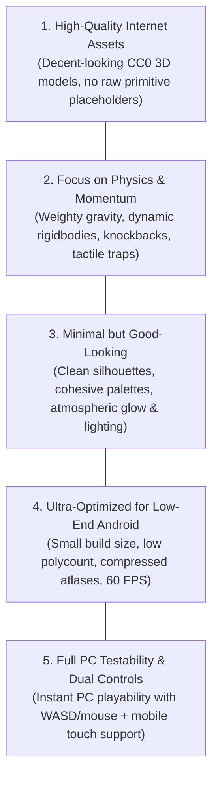

# AI System Instructions & Project Guidelines (Mandatory Pre-Query Directives)

> **CRITICAL DIRECTIVE FOR AI ASSISTANTS**:  
> You MUST read and strictly adhere to every rule in this document **before executing any query, creating any asset, or modifying any code/scene** in this project. These guidelines define the core design philosophy, technical constraints, and quality standards for **AetherBound**.

---

## 1. Core Mandates Summary

---

## 2. Asset Sourcing: Internet Assets of Decent Quality
- **No Ugly Primitives**: Never use raw, untextured primitive shapes (cubes, capsules, cylinders) for visible characters, interactive items, or obstacles. Primitives are ONLY allowed as invisible math/trigger colliders.
- **Internet Sourced & Open-License**: All 3D models, textures, and audio must be acquired from reputable, open-license internet repositories (CC0 / Public Domain / Permissive commercial-use packs like KayKit, Kenney, Skywolf, OpenGameArt).
- **Stylized Consistency**: Maintain a cohesive low-poly fantasy/adventure art style across all models:
  - Characters: Stylized humanoid adventurers with expressive equipment (Knight, Rogue, Mage).
  - Environment: Low-poly conifer and broadleaf foliage, weathered dungeon masonry, ancient runic monoliths.
  - Palettes: Texture atlas sharing; avoid standalone individual diffuse textures when a shared palette atlas is available.
- **URP Shader Compatibility**: Every model must use **Universal Render Pipeline (URP)** shaders (`Universal Render Pipeline/Lit` or `Universal Render Pipeline/Simple Lit`).

---

## 3. Gameplay & Physics: Tactile, Weighty & Dynamic
- **Momentum & Kinetic Feel**: Movement must not feel floaty or disconnected:
  - Runner gravity must feel crisp and grounded (target `-20` to `-24 m/s²`).
  - Implement responsive platforming safeguards: **Coyote Time** (`0.12s - 0.15s`) and **Jump Buffering** (`0.10s - 0.12s`).
- **Dynamic Rigidbody Interactions**:
  - Traps must exert real physics: explosive barrels impart radial impulse forces; rolling boulders possess genuine mass, rolling down slopes and bouncing off barricades.
  - Characters and objects must use smooth interpolation (`Interpolate`) on moving Rigidbodies to eliminate camera jitter.
  - Obstacles, walls, and terrain must have correct `PhysicMaterial` setups (friction, bounciness) where appropriate.
- **Predictable Collision Geometry**: Keep collision meshes simple (Box, Capsule, Sphere, or simplified convex MeshColliders) for fast physics evaluation and zero tunneling.

---

## 4. Aesthetics: Minimalist Yet Beautiful
- **Clutter-Free Minimalism**: Favor clean geometry, open sightlines, and uncluttered visual hierarchy over dense, noisy clutter.
- **Atmospheric Palette & Mood**:
  - Aether energy = Vibrant cyan / teal glow (`#00FFFF`, `#00E5FF`).
  - Shadow energy = Deep obsidian and vibrant purple / crimson glow (`#8A2BE2`, `#FF1493`).
  - Terrain = Natural earthy tones (rich grass greens, warm dirt paths, cool slate rock).
- **Lighting & Post-Processing**:
  - Warm directional sunlight with subtle ambient fill.
  - Runic emission highlights utilizing lightweight URP Bloom.
  - Height or distance fog to provide depth perception without rendering heavy far-distance geometry.

---

## 5. Mobile Optimization: Low-End Android Ready & Small Game Size
- **Small Binary & Storage Footprint**:
  - Total build size must be kept minimal (target `< 100 MB` for APK / Standalone, `< 50 MB` for WebGL assets).
  - Compress textures to appropriate mobile formats (ASTC for Android, WebP / DXT for desktop/web). Max texture size: `1024x1024` for atlases; `512x512` or lower for standalone props.
- **Strict Triangle & Draw Call Budgets**:
  - Maximum scene frame budget: `< 50,000` triangles; `< 70` draw calls.
  - Enable **GPU Instancing** on all repetitive foliage, tree, and obstacle materials.
- **Zero Runtime Garbage Collection (GC)**:
  - Never instantiate/destroy objects in hot update loops.
  - Use pre-allocated **Object Pooling** for particles, traps, barrels, and projectiles.
  - Avoid boxing, string allocations (`+`), and `GetComponent` inside `Update()` / `FixedUpdate()`.
- **Target Performance**: Smooth, locked **60 FPS** on entry-level Android chipsets (e.g., Mali-G52, Adreno 610, 3GB RAM).

---

## 6. PC Testability: Smooth Desktop Pair Programming
- **Immediate In-Editor Playability**:
  - The game must be 100% playable right inside the Unity Editor on PC using standard Keyboard & Mouse.
  - Keyboard mappings: `WASD` / Arrow keys for movement, `Space` for jump, `Left Shift` for sprint, `Left/Right Click` for actions.
  - Cursor Management: Mouse cursor must lock into center for smooth 3D camera look, with `Escape` or `Alt` cleanly releasing the cursor for UI interaction.
- **Simultaneous Dual Input Architecture**:
  - Desktop keyboard/mouse controls and Mobile touch controls (virtual joysticks, touch look zones) must coexist peacefully. Mobile controls auto-display on touch-enabled devices or when simulated in editor.
- **Frame-Pacing & Zero Freezes**:
  - The game must run buttery smooth on PC with high refresh rate support, zero hitching during asset spawning, and zero compile or runtime console errors.

---

## 7. Mandatory AI Workflow Before Completing Any Query

Before declaring any task or query complete, the AI agent MUST perform this 4-step checklist:

1. **Asset Validation**: Did I use a decent-looking 3D model / texture from the internet? (Reject raw cubes/capsules).
2. **Compilation & Error Check**: Call `Unity_ReadConsole` or verify with MCP to ensure zero errors and zero unhandled warnings exist.
3. **Play Mode Sanity Check**: Ensure the game can enter Play Mode (`IsPlaying: true`) cleanly and exit without leaking memory or throwing exceptions.
4. **Performance & Cross-Platform Review**: Confirm that changes preserve low draw calls, small size, and keyboard/touch parity.
